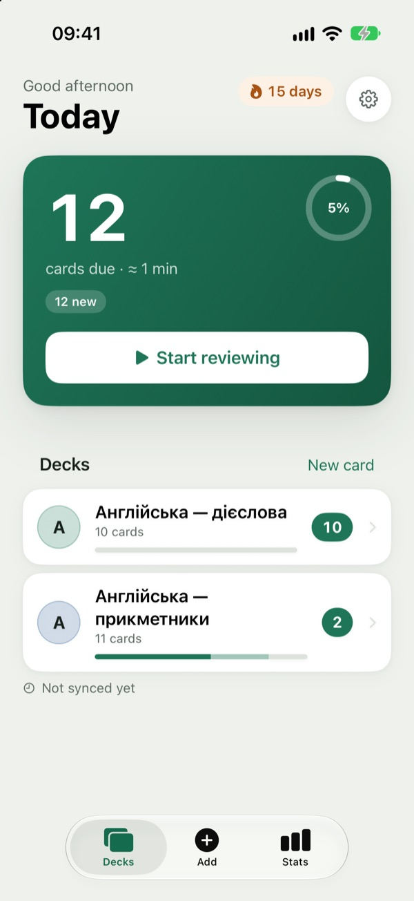
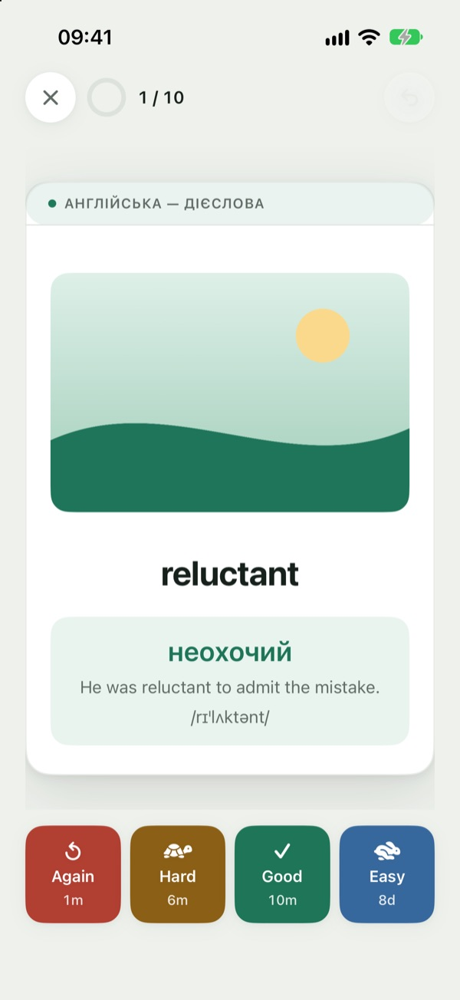
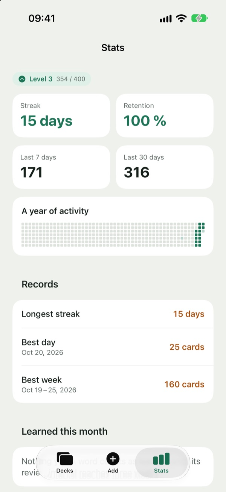
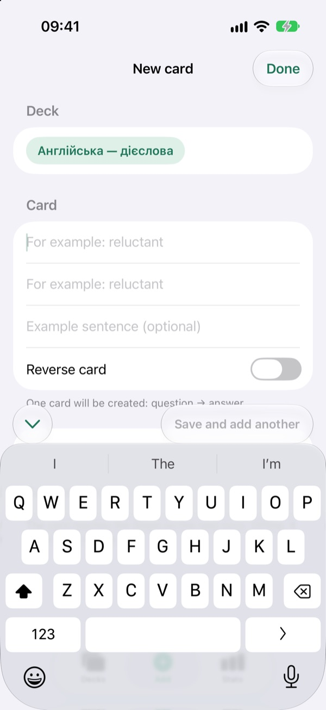
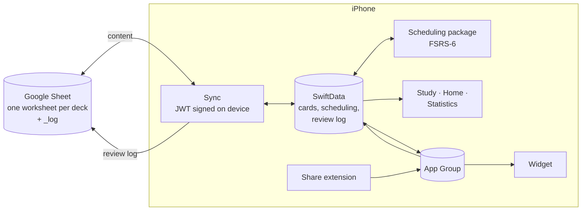

# Repeat

**A spaced-repetition flashcard app for iPhone that keeps your cards in a Google Sheet.**
You write and edit cards in a spreadsheet (one worksheet per deck) or in the app, and the phone
schedules reviews with FSRS-6, the algorithm modern Anki uses. A daily session takes under ten
minutes, starts with one tap, and works offline.


<table>
  <tr>
    <td></td>
    <td></td>
    <td></td>
    <td></td>
  </tr>
  <tr>
    <td align="center">Home</td>
    <td align="center">Review</td>
    <td align="center">Statistics</td>
    <td align="center">New card</td>
  </tr>
</table>

---

## Why it exists

- **Your cards stay in a spreadsheet you own.** Sorting, bulk edits and imports happen in Google
  Sheets, and the app syncs both ways. The Sheet owns the card *content* and the phone owns the
  *scheduling*, so the two never argue about who is right.
- **Scheduling on par with modern Anki.** FSRS-6, with a preview under each grade of when the
  card comes back.
- **Built for a daily habit.** A goal ring, streaks with freezes, reminders and a home-screen
  widget make the ten minutes easy to keep.

## Features

### Studying
- FSRS-6 scheduling through [`swift-fsrs`](https://github.com/open-spaced-repetition/swift-fsrs),
  with user-tunable parameters.
- Type-the-answer mode with a character-level diff, gap (cloze) cards, and offline text-to-speech.
- Leech detection for cards that keep being forgotten, and catch-up that spreads a backlog over
  three days.
- Pictures on cards from Google Images, Google Drive, ImgBB or Gemini share links.
- Tags per deck that scope every session.

### Adding cards
- **Share extension:** send a word from Safari or any other app straight into a deck.
- **AI autofill:** Claude suggests the answer side and an example sentence for a new card. It
  uses your own Anthropic key, kept in the Keychain.
- **Shortcuts (App Intents):** add a card, start a review, or ask how many cards are due.
- Browse and edit a deck's cards in the app.

### Sync and safety
- Google Sheets API v4 over plain REST, with no Google SDK. The service-account JWT is signed on
  the device (RS256 with `SecKeyCreateSignature`), and the key lives in the Keychain.
- Offline-first, with background refresh. When the Sheet overrules an edit made in the app,
  both versions are listed for you to re-apply or drop, so nothing is overwritten silently.
- The append-only review log is pushed to a `_log` worksheet, so scheduling can be rebuilt by
  replaying it. Nightly scheduling backups can be restored too.

### Habit
- Daily goal ring, streaks with freezes, records (longest streak, best day, best week), a review
  heatmap, achievements and XP.
- Reminders: daily, evening, and when a streak is at risk.
- Lock-screen and home-screen widget with the due count, the goal ring and the streak.
- Ukrainian UI with English fallback, light and dark appearance.

## How it works



Card content flows both ways between the Sheet and the phone. Scheduling state never leaves the
phone except as the review log, which is enough to rebuild it.

## Tech stack

| Layer | Tools |
|---|---|
| **App** | Swift, SwiftUI, SwiftData, Swift Concurrency, WidgetKit, App Intents, Share extension, AVSpeechSynthesizer |
| **Scheduling** | Local `Scheduling` package wrapping `swift-fsrs` (FSRS-6), the only third-party dependency |
| **Sync** | Local `GoogleSheets` package: Sheets API v4 over URLSession, RS256 JWT via Security.framework |
| **AI (optional)** | Anthropic Messages API for card autofill, model configurable in Settings |
| **Quality** | XCTest unit and UI tests, Swift package tests that run without a simulator |
| **Project** | XcodeGen (`project.yml` is the source of truth) |

## By the numbers

| | |
|---|---|
| Swift in the app and packages | ~22,000 lines |
| App unit tests | 812 |
| App UI tests | 30 |
| `Scheduling` package tests | 36 |
| `GoogleSheets` package tests | 72 |
| Third-party dependencies | 1 (`swift-fsrs`) |

## Quick start

**You need:** Xcode and [XcodeGen](https://github.com/yonaskolb/XcodeGen).

```sh
brew install xcodegen          # once
xcodegen generate              # after any project.yml change or target/file addition
open Repeat.xcodeproj
```

Pick an iPhone simulator and press Run. To see the app with a sample deck and no Google account,
add these launch arguments to the scheme (Debug builds only):

```
-resetStoreOnLaunch -seedSampleDataOnLaunch -seedTagsOnLaunch -cannedSheetOnLaunch
```

To use your own spreadsheet, create a Google Cloud service account, share the Sheet with its
`client_email` as an Editor, and paste the key JSON in **Settings → Google Sheets**.
`scripts/set-default-connection.sh` can bake a connection into a personal build instead (see
`Config/DefaultConnection.json.template`; the generated file is gitignored).

The full design is in [`docs/repeat-app-spec.md`](docs/repeat-app-spec.md), and
[`docs/anki-ios-mockup.html`](docs/anki-ios-mockup.html) is the interactive mockup the screens
were built from.

## Project structure

```
Repeat/                  the app: Study, Sync, Models, Notifications, Pictures, Backup, Views, …
RepeatWidget/            WidgetKit due count, goal ring and streak
RepeatShareExtension/    quick capture from any app
Packages/Scheduling/     FSRS-6 behind app-owned value types
Packages/GoogleSheets/   Sheets API v4 client and on-device JWT signing
Tests/                   RepeatTests (unit) and RepeatUITests
Config/                  xcconfig and templates for local signing and the default connection
docs/                    specification and design mockup
```

## Developer notes

### Building from the command line

If `xcodebuild` reports that it requires Xcode, the active developer directory is pointing at
the Command Line Tools. Either `sudo xcode-select -s /Applications/Xcode.app/Contents/Developer`
once, or prefix commands with `DEVELOPER_DIR=/Applications/Xcode.app/Contents/Developer`.

```sh
xcodebuild -project Repeat.xcodeproj -scheme Repeat \
  -destination 'platform=iOS Simulator,name=iPhone 17' test
cd Packages/Scheduling && swift test     # fast, no simulator needed
cd Packages/GoogleSheets && swift test
```

### Signing

Simulator builds need no setup. For a device build, copy the template and fill in your Team ID:

```sh
cp Config/Local.xcconfig.template Config/Local.xcconfig
```

`Config/Local.xcconfig` is gitignored, so the Team ID never enters the repo.

> **App Groups require a paid Apple Developer Program membership.** On a free personal team the
> entitlement is rejected, `AppGroup.containerURL` returns `nil`, and the widget and Share
> Extension cannot exchange data with the app.

### Targets

| Target | Bundle ID | Purpose |
|---|---|---|
| `Repeat` | `com.goodglor.repeat` | The app. iOS 17+, iPhone, portrait. URL scheme `repeat://` |
| `RepeatWidget` | `com.goodglor.repeat.widget` | WidgetKit due count (spec §7.1) |
| `RepeatShareExtension` | `com.goodglor.repeat.share` | Quick capture from anywhere (spec §7.3) |
| `RepeatTests` | `com.goodglor.repeat.tests` | Unit tests |
| `RepeatUITests` | `com.goodglor.repeat.uitests` | UI tests |

The app and both extensions share the App Group `group.com.goodglor.repeat`.

### The `Scheduling` package

`Packages/Scheduling` is a local Swift package that owns `swift-fsrs` outright. **The app does not
depend on the library and must not.** The reason is concrete: `swift-fsrs` exports `Card`,
`CardState` and `ReviewLog`, all names the app also declares, and its module cannot disambiguate
them. The package contains a *class* named `FSRS` which shadows the module, so `FSRS.Card`
resolves to a member of the class and fails to compile. Inside the package no such names exist, so
the library's types resolve cleanly.

The package exposes value types (`CardSchedulingSnapshot`, `Grade`, `SchedulingState`,
`GradePreview`, `GradeOutcome`) and the app maps its SwiftData models to them. The boundary is
enforced by the build rather than by convention.

The FSRS dependency is pinned to an exact **revision**, not a tag, in the package's `Package.swift`.
Spec §5.1 requires FSRS-6 (21-parameter `w`), which is merged on `swift-fsrs` `main` but is not in
any release. The newest tag, `v5.0.0`, is FSRS-5 only. Revisit the pin when upstream tags a release
containing `BasicSchedulerV6`.

## License

© 2026 Artem Levkovich. All rights reserved. The source is published as a portfolio piece.
If you'd like to use it, get in touch.
